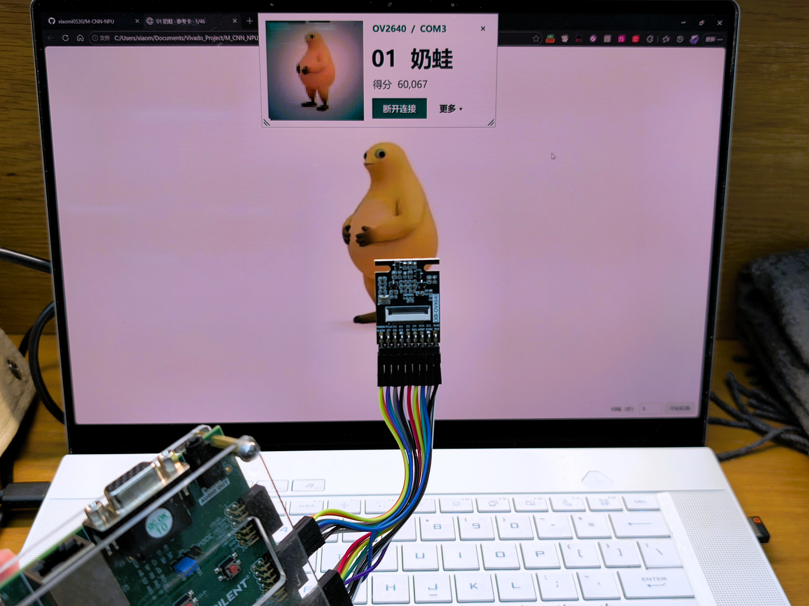
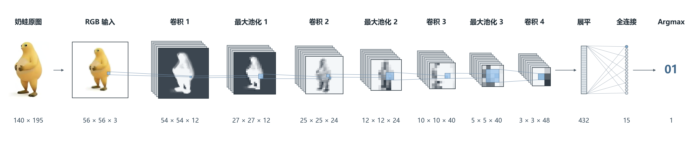
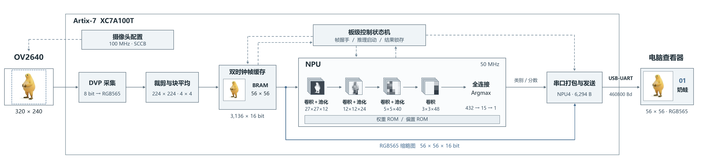
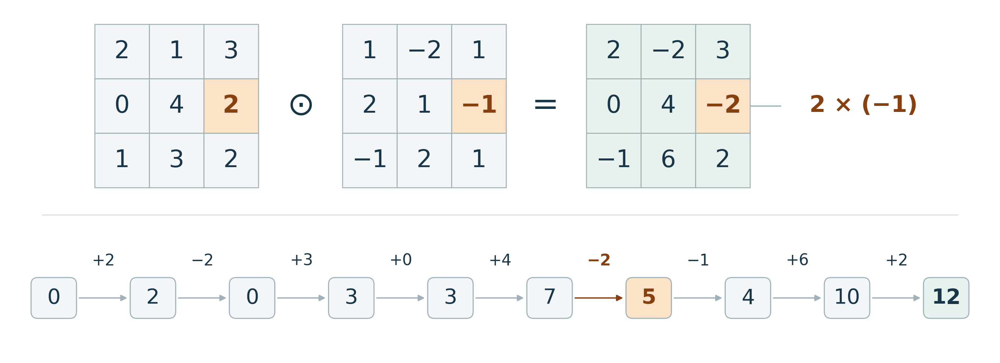
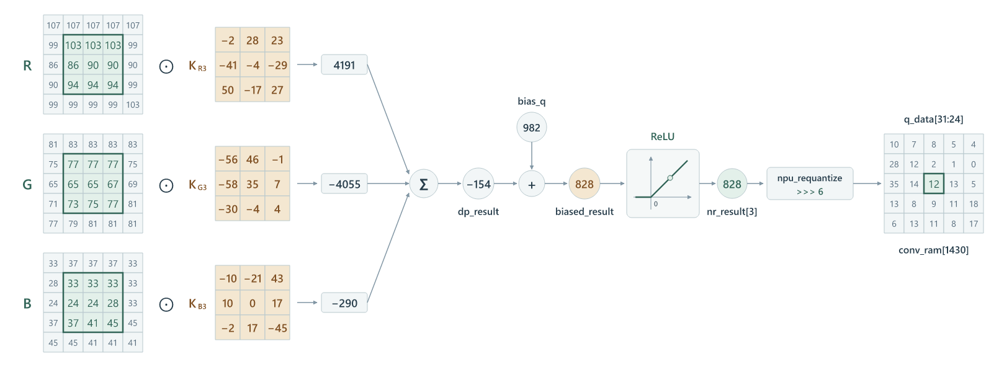
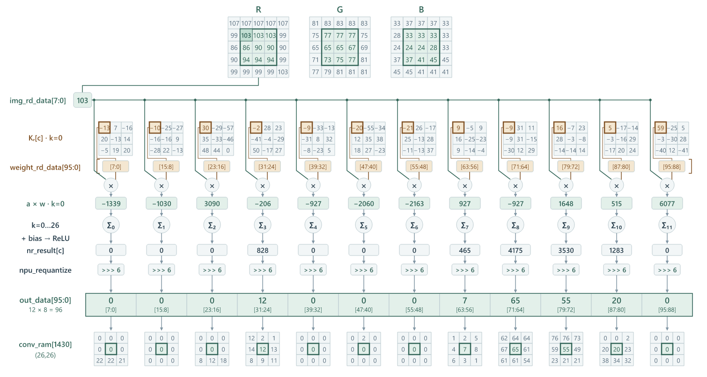
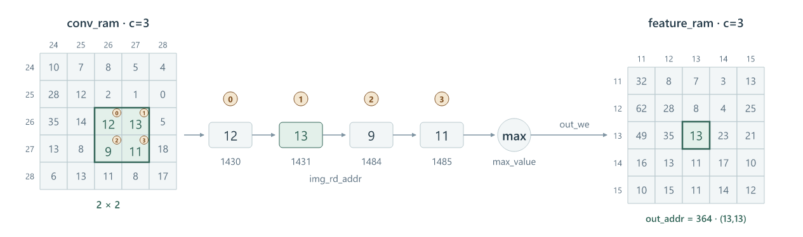
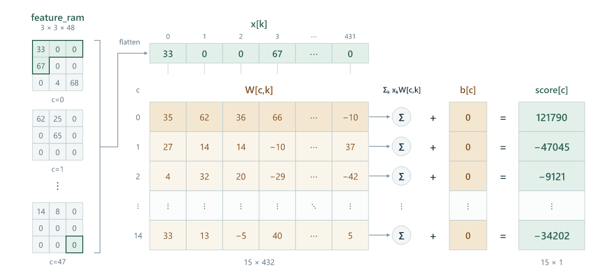

<!-- Generated by GPT-6.2 Astra -->

# M-CNN-NPU · 奶家人分类器

从一个乘加器开始，用 SystemVerilog 在 FPGA 上搭建一款能够分类 **15 种奶家人**的小型卷积神经网络 NPU。

奶家人的配色和神态相近，轮廓却各不相同，正适合拿来做一次图像分类实践。本项目使用 **Nexys A7-100T + OV2640**，完成摄像头采集、图像预处理、整数 CNN 推理与串口结果展示的完整链路。模型在电脑上训练，权重固化到 FPGA 的 ROM 中，分类计算由 RTL 完成。

配套推文：[DESIGN#003 从零搭建一款能够分类奶家人的 FPGA 上卷积神经网络 NPU](https://mp.weixin.qq.com/s/_SW__BvQuDceLBh6SVXoYw) · 公众号：**重现科学**



[观看 44 秒实机演示](docs/passage/img/437c25e5847f2ab05ee9084b4e3e3f6e.mp4)

## 项目概况

| 项目 | 当前配置 |
| --- | --- |
| FPGA | Artix-7 `xc7a100tcsg324-1`，Nexys A7-100T 开发板 |
| 摄像头 | OV2640，320 × 240，RGB565，8 位 DVP 接口 |
| 网络输入 | 56 × 56 × 3，RGB 三通道 |
| 网络结构 | 4 层卷积 + 3 层最大池化 + 1 层全连接 + Argmax |
| 数值格式 | INT8 权重与特征，INT32 偏置、累加结果及分类分数 |
| 参数量 | 35,455 个权重与偏置，量化数据共 35,872 B，约 35.03 KiB |
| 单次计算量 | 3,590,784 MAC，约 3.59 M |
| NPU 时钟与推理耗时 | 50 MHz，约 11.35 ms / 次 |
| 电脑通信 | UART，460,800 baud，回传输入缩略图、类别、分数与推理周期数 |
| 真实测试集成绩 | 50 / 65，**76.9%** |

推理耗时不含摄像头采集和串口传输。35.03 KiB 是权重与偏置的有效数据量，不包括中间特征图、帧缓存和 BRAM 分配开销。

类别映射以 [`classes.json`](model/role56/classes.json) 为准。界面使用 01–15，RTL 和 UART 使用从 0 开始的 `wire_id`。

| 编号 | 类别 | 编号 | 类别 | 编号 | 类别 |
| --- | --- | --- | --- | --- | --- |
| 01 | 奶蛙 | 06 | 奶狗 | 11 | 豆奶 |
| 02 | 奶蛋 | 07 | 奶粉 | 12 | 奶兔 |
| 03 | 小奶蛙 | 08 | 奶鸡 | 13 | 奶鱼 |
| 04 | 奶鼠 | 09 | 奶猫 | 14 | 奶茶 |
| 05 | 奶豆 | 10 | 奶屎 | 15 | 奶瓶 |

## 神经网络结构



四层卷积均采用 **3 × 3 卷积核、stride = 1、无 padding**，卷积后执行 ReLU 和重量化。前三层卷积后接 **2 × 2、stride = 2** 的最大池化，第四层直接展平后送入全连接层。

| 层 | 操作 | 输出尺寸（H × W × C） |
| --- | --- | --- |
| Input | RGB 输入 | 56 × 56 × 3 |
| Conv1 | 3 → 12 通道，ReLU，右移 6 位 | 54 × 54 × 12 |
| MaxPool1 | 2 × 2 最大池化 | 27 × 27 × 12 |
| Conv2 | 12 → 24 通道，ReLU，右移 7 位 | 25 × 25 × 24 |
| MaxPool2 | 2 × 2 最大池化，舍弃末尾不完整窗口 | 12 × 12 × 24 |
| Conv3 | 24 → 40 通道，ReLU，右移 9 位 | 10 × 10 × 40 |
| MaxPool3 | 2 × 2 最大池化 | 5 × 5 × 40 |
| Conv4 | 40 → 48 通道，ReLU，右移 8 位 | 3 × 3 × 48 |
| Flatten | 按通道展平 | 432 |
| FC | 432 → 15，不使用 ReLU | 15 个 INT32 分数 |
| Argmax | 选取最大分数 | 类别编号与最大分数 |

RGB565 输入的各颜色分量先映射到 0–127，供 INT8 数据通路使用。每层卷积先用 INT32 累加并加偏置，再经过 ReLU、算术右移和饱和截断，得到下一层所需的 8 位特征。通用重量化模块支持 −128–127；在本网络的 ReLU 之后，输出范围为 0–127。

当前通道数与移位参数保存在 [`config.tcl`](model/role56/config.tcl) 中。全连接层保留有符号分数，直接交给 Argmax；界面中的“得分”是整数模型输出，不是概率。

## 硬件数据链路



1. **配置摄像头**：通过 SCCB 读取 OV2640 芯片 ID，并写入寄存器配置。
2. **采集和缩小图像**：接收 320 × 240 的 RGB565 画面，截取中央 224 × 224 区域，对每个 4 × 4 像素块的颜色分量分别求均值，得到 56 × 56 输入。
3. **保存一帧**：通过双时钟帧缓存衔接摄像头像素时钟域与 NPU 时钟域，一帧图像的有效数据量为 6,272 B。
4. **执行分类**：板级状态机启动 NPU，依次完成四级卷积、前三次池化、全连接与 Argmax，并锁存类别、分数和周期数。
5. **回传结果**：将分类结果与同一帧缩略图封装成 `NPU4` 数据包，经 UART 发往电脑。发送完成后释放帧缓存，准备下一次采集。

一包 `NPU4` 数据共 **6,294 B**，包含 18 B 包头、6,272 B RGB565 像素和 4 B 字节和校验。电脑端解析逻辑见 [`character_twin.py`](tools/character_twin.py)，发送逻辑见 [`camera_npu_uart.sv`](rtl/uart/camera_npu_uart.sv)。

## 从 MAC 到 NPU 的 RTL 实现

核心思路是逐层复用：**MAC → 点乘 → 神经元 → 卷积 / 全连接 → 完整网络**。同一层的输出通道并行计算，各通道内部按顺序读取输入并累加；不同网络层按完成信号依次启动。

| 模块 | 职责 |
| --- | --- |
| [`npu_mac.sv`](rtl/npu/npu_mac.sv) | 两个有符号 8 位数相乘，以 32 位累加；支持清零、有效输入及末项标记 |
| [`npu_dot_product.sv`](rtl/npu/npu_dot_product.sv) | 控制 RAM 读取和数据等待，向 MAC 顺序送入 N 对数据 |
| [`npu_neuron.sv`](rtl/npu/npu_neuron.sv) | 点乘结果加偏置，并按 `RELU_EN` 决定是否执行 ReLU |
| [`npu_requantize.sv`](rtl/npu/npu_requantize.sv) | 将 INT32 结果算术右移，饱和截断为 INT8 |
| [`npu_conv_multi.sv`](rtl/npu/npu_conv_multi.sv) | 滑动窗口、转换读取地址，并行计算多个输出通道 |
| [`npu_maxpool2d.sv`](rtl/npu/npu_maxpool2d.sv) | 对每个 2 × 2 窗口串行比较，输出最大值 |
| [`npu_conv_multi_maxpool2d.sv`](rtl/npu/npu_conv_multi_maxpool2d.sv) | 组合卷积、可选池化、权重 ROM 和特征 RAM |
| [`npu_fc.sv`](rtl/npu/npu_fc.sv) | 并行计算各类别神经元，依次输出分类分数 |
| [`npu_argmax.sv`](rtl/npu/npu_argmax.sv) | 逐个比较有符号分数，输出最大值及类别编号 |
| [`npu_top.sv`](rtl/npu/npu_top.sv) | 串联四级卷积、全连接和 Argmax，提供推理握手接口 |
| [`camera_npu_top.sv`](rtl/board/camera_npu_top.sv) | 连接摄像头、帧缓存、NPU、UART 与板级显示 |

<details>
<summary>展开：乘加、点乘与神经元</summary>

一个卷积输出需要把窗口内的输入与对应权重逐项相乘，再累加。MAC 完成运算，点乘模块通过 `READ → WAIT_DATA → FEED` 循环处理存储器读取时序，神经元再补上偏置和激活。



相关波形：[9 次乘加](docs/waveforms/npu_mac_nine.png) · [9 项点乘](docs/waveforms/npu_dot_product_nine.png) · [神经元工作过程](docs/waveforms/npu_neuron_nine.png)

</details>

<details>
<summary>展开：多通道卷积与输入复用</summary>

第一层从 RGB 的 3 个输入通道得到 12 个输出通道，共需要 3 × 12 个 3 × 3 卷积核。计算某个输出通道的一个位置时，将三个输入窗口和对应权重按相同顺序展平，执行 27 次 MAC，再加上该输出通道的偏置。



12 个输出通道的窗口位置保持同步，共享当前输入特征值。权重 ROM 的一次读取返回所有输出通道在当前位置的权重，每个神经元取其中的 8 位；计算结束后，各通道结果打包写入特征 RAM。



相关波形：[卷积层读取与结果写回](docs/waveforms/npu_conv_multi_representative.png)

</details>

<details>
<summary>展开：最大池化与层间缓存</summary>

最大池化逐个读取 2 × 2 窗口中的四个数，通过比较保留最大值。本设计先将一层卷积结果保存到 RAM，再启动各通道的池化模块；池化完成后，下一层读取最终特征 RAM。第四级关闭池化，直接保存卷积结果。



相关波形：[卷积结束并启动池化](docs/waveforms/npu_conv_pool_handoff_conv.png) · [下一层读取池化结果](docs/waveforms/npu_conv_pool_handoff_dst.png)

</details>

<details>
<summary>展开：全连接与 Argmax</summary>

最后的 3 × 3 × 48 特征图展平为 432 项向量。15 个神经元分别使用各自的权重向量，同时计算 15 个类别分数。全连接层不启用 ReLU，计算后串行输出分数，Argmax 边接收边比较，最终给出类别和最大分数。



相关波形：[15 路并行计算](docs/waveforms/npu_fc_live_parallel.png) · [分数串行输出](docs/waveforms/npu_fc_live_scores.png) · [Argmax 收尾](docs/waveforms/npu_argmax_live_tail.png)

</details>

## 使用方法

以下命令均在项目根目录执行。工程脚本以 Windows 环境为主，启动器支持查找 `PATH` 中的 Vivado，并兼容默认安装位置 `C:\Xilinx\2025.1\Vivado\bin`。

### 1. 准备 Python 环境

电脑查看器、整数推理和验证脚本使用 Python、NumPy、Pillow；连接板卡还需要 pyserial。图形窗口依赖 Tkinter。

```powershell
python -m pip install numpy Pillow pyserial
```

仓库包含 `model/role56/` 下的整数模型、类别表、配置和 `.mem` 参数。**数据集 `dataset/`、构建目录 `build/` 和本地发布目录 `release/` 不随 Git 提交。** 使用自备图片或接收板卡数据可直接运行查看器；重新训练、软件评测及生成 RTL 仿真向量需要另外准备对应数据集。

### 2. 在电脑上运行整数模型

双击根目录的 `启动电脑孪生.cmd`，或执行：

```powershell
python -B -X utf8 tools/character_viewer.py
```

使用自己的角色图片测试，将下面的文件名替换为实际路径：

```powershell
python -B -X utf8 tools/character_viewer.py --image "角色图片.png"
python -B -X utf8 tools/character_viewer.py --headless --image "角色图片.png"
```

`--image` 按角色卡片方式预处理图片；`--frame` 模拟摄像头整帧的中央裁剪；`--raw` 读取 56 × 56、小端序的 RGB565 文件；`--replay` 读取已保存的 `.npu4` 数据流。`--headless` 输出 JSON，可用于检查类别和完整的 15 项分数。

### 3. 打开 Vivado 工程

双击 `打开Vivado工程.cmd`，或在能找到 Vivado 的终端运行：

```powershell
vivado -mode gui -source scripts/setup_board.tcl
```

脚本会创建或更新 `build/vivado_argmax/M_CNN_NPU.xpr`，添加 RTL、约束与模型 ROM，将综合顶层设为 `camera_npu_top`，仿真顶层设为 `npu_top_tb`。若存在 `dataset/`，脚本还会调用 Python 生成仿真向量，因此该目录应包含完整索引和所引用的图像。

摄像头与开发板的接线以 [`camera_npu_nexys_a7.xdc`](constraints/camera_npu_nexys_a7.xdc) 为准。当前顶层没有输出摄像头 XCLK，所用摄像头模块需要自行具备所需时钟。

<details>
<summary>需要自行生成 bitstream 和下载到开发板时</summary>

构建脚本会执行综合、布局布线、时序检查和 bitstream 生成，结果写入 `build/board_single/`，并复制到 `release/role56/`：

```powershell
vivado -mode batch -source scripts/build_board.tcl
```

连接开发板后，可用以下命令通过 JTAG 下载生成的 bitstream：

```powershell
vivado -mode batch -source scripts/program_board.tcl -tclargs release/role56/camera_npu_top.bit
```

</details>

### 4. 查看 FPGA 识别结果

板卡下载完成并连接 USB-UART 后，在电脑查看器中点击“连接板卡”，选择对应串口。也可以先列出串口，再指定端口启动；下例的 `COM3` 应替换为实际端口：

```powershell
python -B -X utf8 tools/character_viewer.py --list-ports
python -B -X utf8 tools/character_viewer.py --port COM3
```

查看器按 460,800 baud 接收板卡数据，显示 FPGA 实际使用的 56 × 56 输入缩略图、类别和分数，并提供整数模型对照与数据回放功能。

## 训练与验证

训练脚本为 [`train_roles56.py`](tools/train_roles56.py)。当前模型使用 325 张训练原图和 11,520 张训练扩充图，优化器为 AdamW，batch size 为 64，初始学习率为 0.0016。样本划分保存在 [`splits.json`](model/role56/splits.json)，整数模型的逐图分数保存在 [`evaluation.json`](model/role56/evaluation.json)。

| 评测集合 | 正确 / 总数 | 准确率 |
| --- | --- | --- |
| 验证集 | 44 / 58 | 75.9% |
| 测试集 | 50 / 65 | 76.9% |
| 参考角色图 | 15 / 15 | 100% |

参考角色图属于训练侧素材，这一项用于检查演示样本，泛化效果以独立验证集和测试集为准。奶猫与奶鼠等外形接近的类别仍容易混淆。

**软件评测**需要准备与冻结划分匹配的 `dataset/样本索引.jsonl`、原图、`dataset/评测排除.json` 以及 `dataset/训练集/训练扩充.zip`。脚本会检查样本哈希、训练扩充集和逐类整数分数：

```powershell
python -B -X utf8 tools/evaluate_characters.py
```

**RTL 验证**使用 Vivado XSim，同时需要数据集索引和参考角色图生成测试向量。默认检查板级顶层展开，并对一帧输入的四次卷积、三次池化、15 个分数及 Argmax 结果进行核对：

```powershell
python -B -X utf8 scripts/verify_characters.py
```

跨模块修改时运行完整回归，覆盖各算子单元测试、20 组完整输入及 DVP → 板级控制 → UART 数据流，并由电脑孪生模型解码核对串口结果：

```powershell
python -B -X utf8 scripts/verify_characters.py --full
```

若未自动找到 Vivado，可追加 `--vivado-bin "C:\Xilinx\2025.1\Vivado\bin"`。完整回归报告和回放数据默认写入 `build/verification_single/`。以上验证命令只运行仿真，不执行 implementation 或生成 bitstream。

重新训练还需要安装 PyTorch，并准备完整训练数据。训练输出应放到独立候选目录，例如：

```powershell
python -B -X utf8 tools/train_roles56.py --out build/role56_candidate
```

训练脚本输出候选 `integer_model.npz` 和训练记录；它不会自动更新部署目录的 `.mem` 权重。更换部署模型时，需要同步整数模型、ROM、偏置和移位配置，再验证软件与 RTL 的结果一致。

## 目录说明

```text
M_CNN_NPU/
├── rtl/
│   ├── npu/          MAC、神经元、卷积、池化、FC、Argmax 与 NPU 顶层
│   ├── camera/       OV2640 配置、SCCB、DVP 采集与帧缓存
│   ├── uart/         数据包封装与串口发送
│   └── board/        板级顶层 camera_npu_top
├── tb/               算子、完整网络与板级链路测试平台
├── constraints/      Nexys A7 引脚与时序约束
├── model/role56/     量化模型、ROM 参数、类别表、样本划分与评测记录
├── tools/            训练、整数参考模型、向量导出与电脑查看器
├── scripts/          Vivado 工程创建、构建、下载与验证脚本
└── docs/             架构图、原理配图、波形与实机演示
```

## 当前边界与后续方向

本项目侧重把神经网络运算逐层落实为可读、可验证的 RTL。当前实现有输出通道级并行，但点乘数据读取、滑动窗口和网络层调度仍采用较多串行步骤，后续可以围绕访存流水线、窗口复用与 DSP 映射继续优化。

模型针对上述 15 类角色，当前每次正常推理都会从中选择一个类别，没有“未知角色”拒识机制。实机效果还会受画面占比、背景、角度和光照影响；完整系统的刷新速度同时受采集和串口传图限制。

更完整的设计动机、状态机推导与波形讲解见配套推文。README 中的架构图、模块示意图和实机演示均取自本项目的 `docs/` 素材。
